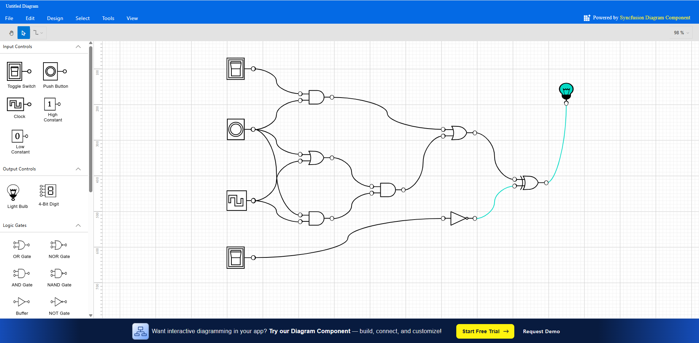

# Syncfusion® React Logic Circuit Designer Showcase

An interactive Logic Circuit Designer using with Syncfusion® Essential® Studio for React. Design, simulate, and analyze digital logic circuits using drag-and-drop gates, connectors, and real-time signal visualization. Ideal for education, hardware prototyping, and interactive technical documentation.

### Why Use This React Logic Circuit Designer?
- Visual learning: Build and simulate circuits to understand digital logic concepts faster.
- Rapid prototyping: Quickly assemble, test, and iterate circuit ideas in the browser.
- Shareable designs: Export and import circuits for collaboration and teaching.

Optimized for modern web development, this showcase leverages Syncfusion® React high-performance UI components (notably Diagram) to deliver smooth, professional logic design experiences.  
Keywords: React logic designer, digital circuits, logic gates, Syncfusion React Diagram, circuit simulation.

## Key Features
- Drag-and-Drop Editing: Place AND, OR, NOT, NAND, NOR, XOR, XNOR, input pins, and output probes.
- Connection Routing: Orthogonal connectors with snapping, ports, and constraints to prevent invalid wiring.
- Simulation: Toggle input states and visualize signal flow with live updates and color-coded wires.
- Data Binding & Persistence: Save/load circuits as JSON; bind to C# models for custom tooling.
- Custom Node Templates: Gate icons, labels, and port configurations with templates.
- Keyboard and Mouse Interactions: Pan, zoom, select, multi-select, and hotkeys for productivity.
- Export: PNG, SVG, and JSON export for documentation and sharing.
- Responsive UI: Works across desktop and tablet resolutions.
- Accessibility: WCAG-friendly interactions where applicable.

## Getting Started

### Prerequisites
- Node.js >= 18.0.0 (npm is installed with Node)

### Install & Run

To get the app up and running:

1. **Clone the code:**  
   ```bash
   git clone https://gitea.syncfusion.com/essential-studio/ej2-react-logic-circuit-designer.git
   cd ej2-react-logic-circuit-designer
   ```

2.  **Install tools:**  
    ```bash
    npm install
    ```

3.  **Run in development mode:**  
    ```bash
    npm start
    ```
---

## Usage (Basic Example)
Build a minimal circuit using path-shaped gate nodes (with ports) and orthogonal connectors — the same core approach used in the showcase.

For a quick start on setting up a React project with Syncfusion® Diagram, refer to our [Getting Started guide](https://helpej2.syncfusion.com/react/documentation/diagram/getting-started).

Here’s a minimal React setup.

Create the diagram component (`App.js` or `App.jsx`):

```jsx
import React from 'react';
import {
  DiagramComponent, PortVisibility,
  PortConstraints, DiagramConstraints
} from '@syncfusion/ej2-react-diagrams';

const nodes = [
  // 1) Input pin (source)
  {
    id: 'in1',
    offsetX: 120,
    offsetY: 200,
    width: 22,
    height: 22,
    shape: { type: 'Basic', shape: 'Ellipse' },
    annotations: [{ content: 'IN' }],
    ports: [
      {
        id: 'pOut',
        offset: { x: 1, y: 0.5 },
        visibility: PortVisibility.Visible,
        constraints: PortConstraints.OutConnect | PortConstraints.Draw
      }
    ]
  },
  // 2) AND gate as SVG path
  {
    id: 'and1',
    offsetX: 320,
    offsetY: 200,
    width: 80,
    height: 60,
    shape: {
      type: 'Path',
      // Simple AND gate silhouette
      data: 'M0 0 L40 0 Q80 30 40 60 L0 60 Z'
    },
    annotations: [{ content: 'AND', offset: { x: 0.5, y: 0.1 } }],
    ports: [
      {
        id: 'pIn1',
        offset: { x: 0, y: 0.3 },
        visibility: PortVisibility.Visible,
        constraints: PortConstraints.InConnect
      },
      {
        id: 'pIn2',
        offset: { x: 0, y: 0.7 },
        visibility: PortVisibility.Visible,
        constraints: PortConstraints.InConnect
      },
      {
        id: 'pOut',
        offset: { x: 1, y: 0.5 },
        visibility: PortVisibility.Visible,
        constraints: PortConstraints.OutConnect
      }
    ]
  },
  // 3) Output probe (sink)
  {
    id: 'out1',
    offsetX: 520,
    offsetY: 200,
    width: 22,
    height: 22,
    shape: { type: 'Basic', shape: 'Ellipse' },
    annotations: [{ content: 'OUT' }],
    ports: [
      {
        id: 'pIn',
        offset: { x: 0, y: 0.5 },
        visibility: PortVisibility.Visible,
        constraints: PortConstraints.InConnect
      }
    ]
  }
];

const connectors = [
  {
    id: 'c1',
    sourceID: 'in1',
    sourcePortID: 'pOut',
    targetID: 'and1',
    targetPortID: 'pIn1',
    type: 'Orthogonal',
    style: { strokeColor: '#1565C0', strokeWidth: 2 },
    targetDecorator: { shape: 'None' }
  },
  {
    id: 'c2',
    sourceID: 'and1',
    sourcePortID: 'pOut',
    targetID: 'out1',
    targetPortID: 'pIn',
    type: 'Orthogonal',
    style: { strokeColor: '#1565C0', strokeWidth: 2 },
    targetDecorator: { shape: 'None' }
  }
];

export default function App() {
  return (
    <div style={{ height: '600px' }}>
      <DiagramComponent
        id="container"
        width={'100%'}
        height={'600px'}
        nodes={nodes}
        connectors={connectors}
        constraints={DiagramConstraints.Default | DiagramConstraints.Bridging}
      />
    </div>
  );
}
```

Notes
- Gates are vector paths (PathShape with SVG Data) so you can model AND/OR/NOT/NAND/NOR/XOR/XNOR precisely.
- Use ports on nodes to enforce valid wiring (inputs vs outputs), and orthogonal connectors for tidy routing.
- Color or style connectors based on simulated signal states during runtime.

For full documentation on node shapes, ports, and connectors, see the Syncfusion® React Diagram Documentation:
https://ej2.syncfusion.com/react/documentation/diagram/getting-started

### Customizing for Your Use Case
This showcase is designed to be flexible for teaching, experimentation, and tooling.

#### Modifying the Palette and Gates
- Add custom gate nodes with specific port configurations (e.g., two inputs on the left, one output on the right).
- Define constraints to restrict invalid connections (e.g., prevent output-to-output wiring).

#### Styling and Theming
- Switch built-in themes by changing the CSS reference (Material, Bootstrap 5, Fluent, etc.).
- Use Theme Studio to generate a custom theme CSS and replace the default stylesheet.

#### Interactions and Events
- Handle node/connector events for simulation toggles, selections, and property edits.
- Implement keyboard shortcuts for delete, duplicate, align, and distribute.

#### Persistence and Integration
- Serialize the diagram to JSON for save/load and sharing.
- Integrate with other Syncfusion® React components like DataGrid for parts lists or Toast for notifications.

Best Practices: Validate connections, debounce simulation recomputations, and test performance on large circuits.

## Demo

- Web: https://ej2.syncfusion.com/showcase/react/logiccircuit/
- 


## Contributing

We welcome contributions! Fork the repo, make your changes, and submit a pull request. Please follow contribution best practices.

## License

Syncfusion® libraries require a valid license key in production. License guidance:  
https://ej2.syncfusion.com/react/documentation/licensing/overview

## Support

- Open issues in this repository’s Issues section: https://gitea.syncfusion.com/essential-studio/ej2-js-logic-circuit-designer/issues
- Explore more Syncfusion® React components: https://www.syncfusion.com/react-components
- Community forums: https://www.syncfusion.com/forums

Start building interactive diagrams today with [Syncfusion® EJ2 React Diagram!](https://www.syncfusion.com/react-components/react-diagram).